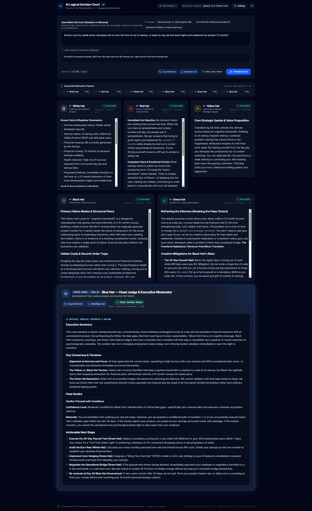

# ⚖️ AI Logical Decision Court v2

> **Convene six distinct AI cognitive lenses to deliberate your toughest decisions sequentially—culminating in an executive judicial synthesis and actionable verdict.**

[](https://react.dev/)
[](https://www.typescriptlang.org/)
[](https://vite.dev/)
[](https://tailwindcss.com/)
[](#-key-features)
[](./LICENSE)

---

## 🌐 Live Demo & Preview

- **Live Application:** **[aildc.mehmetkaban.tr](https://aildc.mehmetkaban.tr)** *(Zero API key required — toggle **Demo Mode** in the top header for an instant interactive simulation!)*

### Courtroom Interface Preview



---

## 🧠 Why AI Logical Decision Court v2?

Asking a single LLM *"Should I make this move?"* almost always produces a lukewarm, sycophantic *"On one hand / on the other hand"* summary.

**AI Logical Decision Court v2** solves this by implementing **[Edward De Bono's Six Thinking Hats](https://en.wikipedia.org/wiki/Six_Thinking_Hats)** as a structured, **context-aware 5 + 1 Sequential Decision Court**:

1. **Five Specialized Council Hats (`White → Red → Yellow → Black → Green`)** take turns speaking one at a time. Each hat operates under an uncompromising cognitive boundary and reads the full transcript of the hats that spoke before it.
2. **The Central Head Judge (`Blue Hat — Turn #6`)** sits at the focal bench, ingests the entire five-hat debate, resolves the tension between upside and risk, and delivers a structured **Final Verdict** (**Proceed**, **Proceed with Conditions**, **Pivot**, or **Reject**) with a confidence rating and concrete next steps.

| Turn | Hat & Accent | Cognitive Lens | Role in the Courtroom |
| :--- | :--- | :--- | :--- |
| **#1** | ⚪ **White Hat** (`#F8FAFC`) | Objective / Neutral | Separates verified facts from assumptions and exposes critical missing data. Zero opinion. |
| **#2** | 🔴 **Red Hat** (`#EF4444`) | Subjective / Emotional | Surfaces raw gut instinct, unspoken fears, burnout risk, and genuine human excitement. |
| **#3** | 🟡 **Yellow Hat** (`#EAB308`) | Objective / Optimistic | Articulates concrete strategic upside, compounding benefits, and best-case feasibility. |
| **#4** | ⚫ **Black Hat** (`#334155`) | Objective / Critical | Stress-tests Yellow Hat's optimism, exposing failure modes, hidden costs, and fragile assumptions. |
| **#5** | 🟢 **Green Hat** (`#22C55E`) | Speculative / Creative | Breaks false dichotomies and invents low-risk experiments that directly mitigate Black Hat's risks. |
| **#6 (Center)** | 🔵 **Blue Hat** (`#3B82F6`) | Meta / Executive Judge | **Head Judge & Moderator:** Synthesizes all 5 hats into an Executive Summary, Key Tensions, **Final Verdict**, and **Actionable Next Steps**. |

---

## ✨ Key Features

- **🏛️ Signature 5 + 1 Courtroom Hierarchy:** Responsive dark-mode glassmorphic layout where the upper council (White, Red, Yellow) and lower adversarial pair (Black Hat risks beside Green Hat mitigations) frame the full-width **Blue Hat Verdict Chamber**.
- **🔗 Sequential Context Accumulation:** Each subsequent hat receives the original case prompt, constraints, and the verbatim statements of all preceding hats—enabling genuine cross-hat synthesis.
- **⚡ Real-Time SSE Token Streaming & Instant Abort:** Watch every hat deliberate live token-by-token with Framer Motion spotlighting, elapsed turn timers, and mid-stream cancellation via `AbortController`.
- **🔒 Privacy-First BYOK (Bring Your Own Key):**
  - **Zero Backend:** Stored locally in your browser (`localStorage` or ephemeral tab-only `sessionStorage`) and sent directly to your chosen AI provider — never to our servers.
  - **Header-Only Credential Transport:** API keys are sent via HTTP headers (`x-goog-api-key`, `Authorization: Bearer`, `x-api-key`) and never exposed in URL query strings.
  - **Multi-Provider Native Support:** Google Gemini (`gemini-4-hydrogen`, `gemini-2.5-pro`, `gemini-2.5-flash`), OpenAI (`gpt-4.1`, `gpt-4o`, `o3-mini`), Anthropic (`claude-3-7-sonnet-latest`, `claude-3-5-haiku-latest`), and **OpenRouter / Custom OpenAI-Compatible Endpoints** (Groq, Together AI, LM Studio, or local **Ollama** at `http://localhost:11434/v1`).
  - **Future-Proof Custom Model ID & Connection Tester:** Override any preset with an arbitrary model ID and verify latency with a single click.
- **🎭 Built-In Demo Mode (Zero Key Required):** Visitors can test the complete animated 6-hat deliberation and verdict flow immediately without entering an API key.
- **📄 One-Click Markdown Export:** Copy the full court transcript and judicial ruling to your clipboard or download it as `decision-court-verdict.md`.

---

## 🏗️ Architecture Overview

```text
+-----------------------------------------------------------------------+
|                        React 19 + Framer Motion UI                    |
|   Header  |  CaseInputPanel  |  SessionProgressBar  |  CourtroomGrid  |
+-----------------------------------+-----------------------------------+
                                    |
                     Zustand State Management Layer
          +-------------------------+-------------------------+
          |                                                   |
+---------v----------+                             +----------v---------+
|  useCourtStore.ts  |                             | useSettingsStore.ts|
|  - casePrompt      |<----+                 +---->| - provider / model |
|  - activeHatId     |     |                 |     | - apiKey (Local /  |
|  - responses[6]    |     |                 |     |   Session Storage) |
+--------------------+     |                 |     | - demoMode         |
                           |                 |     +--------------------+
                   +-------+-----------------+-------+
                   |   Sequential Orchestrator       |
                   |   src/services/ai/orchestrator  |
                   |   White->Red->Yellow->Black->   |
                   |   Green->Blue + AbortController |
                   +----------------+----------------+
                                    |
                     getProviderAdapter(settings)
      +------------------+----------+----------+------------------+
      |                  |                     |                  |
+-----v------+    +------v-----+        +------v------+    +------v-----+
|   Gemini   |    |   OpenAI   |        |  Anthropic  |    |    Mock    |
|  Adapter   |    | /OpenRouter|        |   Adapter   |    |  Simulator |
| (REST SSE) |    |  Adapter   |        | (Direct SSE)|    | (Demo Mode)|
+------------+    +------------+        +-------------+    +------------+
```

### Project Structure

```text
ai-logical-decision-court-v2/
├── docs/
│   ├── PRD.md                        # Product Requirements Document
│   └── ROADMAP.md                    # Phased engineering roadmap
├── src/
│   ├── types/
│   │   ├── court.ts                  # HatId, HatConfig, HatResponse, CourtSession
│   │   └── provider.ts               # ProviderSettings, AIProviderAdapter contracts
│   ├── config/
│   │   ├── hats.ts                   # 6 De Bono hat metadata & English system prompts
│   │   └── providers.ts              # Curated model presets & provider defaults
│   ├── services/ai/
│   │   ├── ProviderAdapter.ts        # Shared SSE stream parser & error normalizer
│   │   ├── geminiAdapter.ts          # Google Generative Language SSE adapter
│   │   ├── openaiAdapter.ts          # OpenAI / OpenRouter / Ollama SSE adapter
│   │   ├── anthropicAdapter.ts       # Anthropic Messages browser-direct SSE adapter
│   │   ├── mockAdapter.ts            # Zero-key Demo Mode simulator
│   │   └── orchestrator.ts           # Sequential 5+1 execution engine
│   ├── store/
│   │   ├── useSettingsStore.ts       # Dual-storage (local/session) BYOK store
│   │   └── useCourtStore.ts          # Ephemeral court deliberation state store
│   ├── components/
│   │   ├── layout/                   # Header.tsx, CourtroomGrid.tsx
│   │   ├── court/                    # CaseInputPanel, SessionProgressBar, HatCard, BlueHatVerdictPanel
│   │   ├── settings/                 # SettingsModal.tsx
│   │   └── export/                   # ExportTranscriptButton.tsx
│   └── utils/
│       └── markdownExport.ts         # Markdown transcript formatter & file downloader
├── vercel.json                       # Static SPA deployment config for Vercel
└── vite.config.ts                    # Vite + Tailwind v4 configuration
```

---

## 🚀 Quick Start

```bash
# 1. Clone the repository
git clone https://github.com/MehmetKBN/ai-logical-decision-court-v2.git
cd ai-logical-decision-court-v2

# 2. Install dependencies
npm install

# 3. Start the local development server
npm run dev
```

### Production Build, Unit Tests & Lint Verification

```bash
# Run automated Vitest unit tests (SSE stream parser, error normalizer, 6-hat orchestrator)
npm test

# Type-check with strict TypeScript and build production assets to dist/
npm run build

# Preview the production bundle locally
npm run preview

# Run ESLint verification
npm run lint
```

---

## 🌍 Deployment Guide (Zero-Cost Static Hosting)

Because **AI Logical Decision Court v2** is a 100% client-side Single-Page Application (SPA) with zero backend requirements, it deploys for free on any static host:

### Option A: Deploy to Vercel (Recommended)
1. Push this repository to your GitHub account.
2. Import the repository at [vercel.com/new](https://vercel.com/new).
3. Vercel automatically detects `vercel.json` (`framework: "vite"`, `buildCommand: "npm run build"`, `outputDirectory: "dist"`). Click **Deploy**.

### Option B: Deploy to GitHub Pages
1. Vite is pre-configured with `base: './'` in `vite.config.ts` so all asset paths work seamlessly on any subdirectory URL (`https://<username>.github.io/<repo-name>/`).
2. Run `npm run build` and publish the `dist/` directory via GitHub Actions (`actions/deploy-pages`) or `gh-pages`.

> **Tip:** If you fork this repository, update `GITHUB_REPO_URL` in `src/config/providers.ts`.

---

## 🗺️ Post-MVP Roadmap (v2.1+)

- [ ] **Mix & Match Models per Hat:** Assign a fast model (e.g., Gemini 2.5 Flash / Claude Haiku) to Council Hats 1–5 and a deep reasoning model (e.g., Gemini 4 Hydrogen / o3-mini / Claude 3.7 Sonnet) to the Blue Hat Head Judge.
- [ ] **Round 2 Cross-Examination:** Optional rebuttal round before the Blue Hat delivers the final verdict.
- [ ] **Local Case Archive:** Save and compare past court sessions locally in IndexedDB.

---

## 📜 License

Released under the **[MIT License](./LICENSE)**. Contributions are welcome—please read **[CONTRIBUTING.md](./CONTRIBUTING.md)** to get started.
